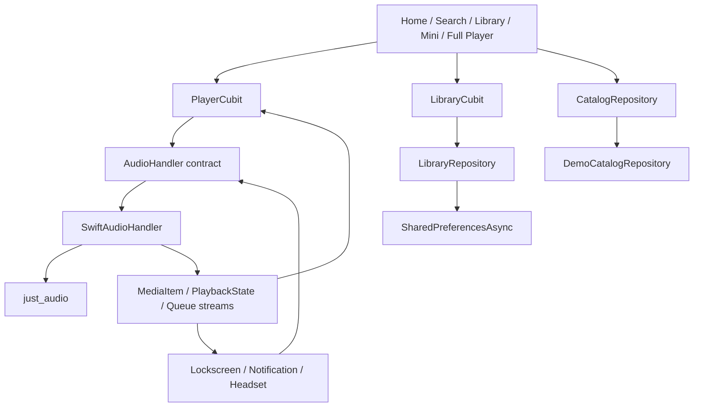

# Swift Music — Flutter / Dart

## Pembaruan 1.4.1

Ikon Open Stream, YouTube dan Spotify dipindahkan ke **Library → Playlists → Streaming**. Efek masuk memakai fade dan pergeseran pendek bertahap, dengan respons skala lembut saat ditekan. Pemilihan sumber di halaman Streaming memberi transisi skala/rotasi logo. Semua mengikuti pengaturan motion dan tidak memakai animasi berulang.

## Pembaruan 1.4.0

Home menambahkan tiga sumber horizontal: Open Stream, YouTube dan Spotify, dengan toggle aktif per sumber. Playlist jaringan, HLS, subtitle pendamping dan pemutar resmi layanan dimuat saat diperlukan. Pemutar layanan tertaut ke sesi Swift Music: mini-player tersedia saat sesi dibuka, dan mulai lagu lokal menghentikan embed agar audio tidak bertumpuk. Spotify tetap menggunakan embed resmi; Soloist/stream native tidak tersedia pada build mobile. [Dukungan aktual, arsitektur dan batas streaming](docs/NETWORK-STREAMING.md).

Halaman Streaming YouTube kini menampilkan situs resmi YouTube Music di dalam Swift Music agar beranda, chart, dan rekomendasi berasal dari layanannya. YouTube Data API key tidak digunakan untuk halaman ini. Login Google di embedded WebView dapat ditolak oleh kebijakan keamanan Google; pemutaran dikelola situs dan tidak masuk ke antrean audio native Swift Music.

## Pembaruan 1.3.0

Sleep timer tersedia lewat ikon bulan di full player. Sesi terakhir dipulihkan dalam keadaan dijeda. Cadangan playlist/favorit tersedia pada menu impor Library, dan Search memiliki filter folder, format, artis, album, serta durasi. [Audit 1.3.0](docs/AUDIT-1.3.0.md).

## Pembaruan 1.2.1

Area lirik pada teks besar kini memakai ruang yang cukup dan halaman dapat digulir. Kontrol media background/layar mati diuji lewat transport media session. [Audit 1.2.1](docs/AUDIT-1.2.1.md).

## Pembaruan 1.2.0

Folder pilihan disimpan dan dapat dipindai ulang, dengan pemeriksaan otomatis tiap menit hanya selama aplikasi aktif. File yang belum berubah dilewati berdasarkan ukuran/waktu modifikasi, dan salinan yang sengaja dihapus tidak diimpor otomatis kembali. Playlist pribadi mendukung pembuatan, perubahan nama, penambahan/pengurutan lagu, serta penghapusan. Antrean dapat diatur tanpa bergantung pada indeks katalog. Lirik TXT/LRC dapat diimpor; LRC menyorot dan menggulir baris sesuai posisi lagu. Tekan lama baris untuk seek, ketuk area album untuk berganti visual.

Metadata judul/artis/album/genre/durasi dan embedded cover dibaca melalui API native, dengan fallback nama file bila tag tidak tersedia. Cover diperkecil hingga 768 piksel. Tidak ada library FFmpeg yang ditambahkan ke APK. Lihat [catatan versi 1.2.0](docs/AUDIT-1.2.0.md).

Library sekarang memiliki **Pilih folder musik** (termasuk subfolder), progres dan pembatalan impor, serta deduplikasi. Wave diperbarui dan penggunaan gambar/daftar lagu dioptimalkan. APK ARM64 sekitar 21 MiB tersedia bersama APK ARM32 dan universal. [Hasil audit fitur, format yang benar-benar diuji dan batas dukungan](docs/AUDIT-1.1.0.md).

Implementasi starter aplikasi musik Android dan iOS menggunakan satu codebase. Referensi gambar diterapkan pada kartu membulat, artwork besar dengan shadow, gradasi ungu/magenta, genre tiles, dan navigasi bawah yang ringkas. Warna inti mengikuti spesifikasi: background `#121212`, surface `#181818`, primary `#1DB954`, teks `#FFFFFF` / `#B3B3B3`.

Kode sumber berada di `lib/`, dan scaffold native Android/iOS sudah dibentuk dengan Flutter 3.47.8 / Dart 3.13.7. Dependensi sudah di-resolve dan dikunci melalui `pubspec.lock`. Analyzer bersih; 52 tes lulus melintasi run audit dan pengujian UI terisolasi. Build Android dan uji emulator dicatat terpisah pada `docs/VERIFICATION.md`; build iOS memerlukan macOS.

## Informasi aplikasi

Ikon launcher memakai desain S putih pada cakram hitam dengan latar hijau, terinspirasi gaya ikon musik JOOX. Master gambar dan prompt ada di `assets/branding/`; konfigurasi pembangkitan di `flutter_launcher_icons.yaml`. Jalankan `dart run flutter_launcher_icons` untuk membuat ulang seluruh ukuran Android/iOS. Ikon Android memakai adaptive foreground dengan inset aman agar simbol tetap utuh pada mask bulat maupun kotak membulat. Logo yang sama dipakai di Home dan halaman Tentang.

Informasi aplikasi tersedia melalui **Library → ikon ⓘ → Tentang Swift Music**. Halaman ini menampilkan versi/nomor build dari paket yang terpasang dan developer **ekoardianto.pro@gmail.com**. Versi terbaru proyek adalah **1.4.1 (build 7)**; tampilan mengikuti perubahan versi saat build berikutnya.

## Lagu lokal dari perangkat

1. Buka **Library → Playlists → Pilih lagu lokal**, atau ikon impor di header Library.
2. Pilih satu atau beberapa file dari file picker sistem Android/iOS. Batalkan untuk kembali tanpa mengubah antrean.
3. Lagu muncul pada **Lagu di perangkat** dan dapat diketuk untuk diputar. Lagu lokal juga tersedia lewat Search (kategori Local), Artists/Albums, favorit, dan antrean.

Picker menerima 23 ekstensi termasuk MP3, M4A, AAC, WAV, FLAC, OGG, OPUS, WEBM dan MKA. Dukungan decoding mengikuti codec perangkat; file DRM atau audio rusak tidak dijamin dapat diputar. Tag native dan cover tertanam dibaca saat impor; bila tidak tersedia, aplikasi menggunakan nama file dan placeholder. Audit Android sebelumnya berhasil memutar 10 dari 12 sampel format; AIFF PCM dan CAF ALAC gagal pada emulator tersebut. Rincian ada pada audit 1.1.0.

File disalin secara streaming ke direktori application support privat, bukan hanya menyimpan path sementara picker. Setelah impor selesai, pemutaran file lokal tidak memerlukan internet dan tetap tersedia setelah restart aplikasi, sekalipun file asal dipindahkan. Isi file di-hash untuk mencegah duplikasi. Metadata menyimpan nama relatif agar pemulihan tidak terikat path absolut sandbox iOS. Menghapus aplikasi/data aplikasi juga menghapus salinan yang diimpor. File asli tidak diubah.

Pemilihan file menggunakan file picker sistem, sehingga tidak memerlukan pemindaian seluruh storage atau penambahan izin `MANAGE_EXTERNAL_STORAGE`/`READ_MEDIA_AUDIO`. Di iOS pilih file audio melalui Files/document picker; fitur ini tidak mengambil lagu DRM dari katalog Apple Music. Jika memilih file cloud yang belum tersedia offline, penyedia file mungkin perlu mengunduhnya saat impor. Katalog demo streaming tetap tersedia terpisah dari file lokal.

Source tambahan: `local_audio_store.dart` untuk penyimpanan, `device_catalog_repository.dart` untuk picker dan katalog gabungan, serta `catalog_cubit.dart` untuk status impor dan pembaruan UI. Handler menambahkan source baru ke queue tanpa mengganti posisi lagu yang sedang diputar.

## Mulai menjalankan

Profil emulator lokal yang digunakan adalah **SwiftMusic_API36**. Profil ini dibuat baru dengan partisi data terpisah di `.emulator/SwiftMusic_API36.avd` setelah profil lama menampilkan “Decryption unsuccessful / Reset phone”. Profil lama tidak dihapus atau direset. Direktori runtime `.emulator/` tidak disertakan dalam Git.

Untuk membuka profil baru pada komputer ini, jalankan di terminal tersendiri dan biarkan terminalnya aktif:

```powershell
powershell -ExecutionPolicy Bypass -File tool/start-emulator.ps1
```

Setelah boot, jalankan aplikasi dari terminal lain dengan `tool/flutter.ps1 run --release -d emulator-5580`. Startup, penyimpanan, dan instalasi aplikasi pada profil baru telah diperiksa setelah reboot Android.

Gunakan Flutter stable yang mendukung Dart >=3.10, Android SDK/JDK sesuai `flutter doctor`, serta Android minSdk 24. Proyek ini diverifikasi dengan Flutter 3.47.8. Build iOS memerlukan macOS, Xcode, CocoaPods bila digunakan oleh template Flutter, dan deployment target Runner iOS 15.0.

Di Windows, dari root proyek yang sudah memiliki folder `android/` dan `ios/`:

```powershell
powershell -ExecutionPolicy Bypass -File .\tool\flutter.ps1 devices
powershell -ExecutionPolicy Bypass -File .\tool\flutter.ps1 run -d <device-id>
```

Wrapper `tool/flutter.ps1` memakai `FLUTTER_ROOT` atau Flutter pada PATH, dengan fallback ke `~/develop/flutter`. Ia juga mengenali instalasi lokal Android/JDK di `SwiftOSAndroid`, tanpa mengubah PATH sistem. Jika SDK sudah tersedia pada PATH, perintah `flutter` biasa tetap dapat dipakai.

`tool/bootstrap.ps1` hanya diperlukan jika memulai ulang dari source tanpa folder Android/iOS. Skrip membuat scaffold, mempertahankan kode dan pubspec aplikasi, menyalin template native, mengatur Android minSdk, lalu menjalankan dependency resolution, formatter, analyzer, dan test. Skrip berhenti jika folder native sudah ada untuk menjaga perubahan Anda.

Di macOS atau jika ingin setup manual:

1. Simpan salinan `lib/main.dart`, `pubspec.yaml`, dan README di lokasi lain.
2. Jalankan `flutter create --platforms=android,ios --org com.swiftmusic --project-name swift_music --no-pub .`.
3. Pulihkan ketiga file aplikasi tadi jika template Flutter menimpanya. Hapus hanya `test/widget_test.dart` bawaan counter jika dibuat; pertahankan test aplikasi lainnya.
4. Terapkan file native di Bagian B. Set Android `minSdk = 24` di `android/app/build.gradle.kts` dan deployment target Runner iOS >=13.0 di Xcode. Jika ada Podfile, selaraskan `platform :ios, '13.0'` dengan target Runner.
5. Jalankan:

```sh
flutter pub get
dart format lib test
flutter analyze
flutter test
flutter run
```

Commit `pubspec.lock` setelah dependency resolution sukses supaya versi aplikasi konsisten. Untuk distribusi: `flutter build appbundle`; di macOS setelah signing dikonfigurasi: `flutter build ipa`. Konfigurasi signing/store account belum termasuk.

## Bagian A — Arsitektur dan struktur proyek

Menggunakan feature-first dengan pemisahan domain/data/presentation dan Cubit dari `flutter_bloc`. Cubit cocok untuk aksi langsung player: lebih sedikit boilerplate daripada event BLoC dengan aliran state yang tetap eksplisit. Ini starter berlapis; use-case class terpisah belum diperlukan untuk forwarding satu baris. Repository abstrak dipakai pada katalog dan penyimpanan library. Adapter audio sengaja memakai kontrak `AudioHandler` agar metadata dan kontrol OS konsisten.



```text
swift_music/
├── pubspec.yaml
├── analysis_options.yaml
├── lib/
│   ├── main.dart                      # Composition root dan AudioService.init
│   ├── app/main_screen.dart           # Shell, IndexedStack, bottom navigation
│   ├── core/
│   │   ├── theme/app_theme.dart
│   │   └── widgets/
│   │       ├── artwork.dart
│   │       └── track_tile.dart
│   └── features/
│       ├── about/presentation/about_screen.dart
│       ├── catalog/
│       │   ├── domain/track.dart
│       │   ├── domain/catalog_repository.dart
│       │   ├── data/demo_catalog_repository.dart
│       │   ├── data/device_catalog_repository.dart
│       │   ├── data/local_audio_store.dart
│       │   └── presentation/catalog_cubit.dart
│       ├── home/presentation/home_screen.dart
│       ├── search/presentation/search_screen.dart
│       ├── library/
│       │   ├── data/library_repository.dart
│       │   └── presentation/
│       │       ├── library_cubit.dart
│       │       └── library_screen.dart
│       └── player/
│           ├── data/swift_audio_handler.dart
│           └── presentation/
│               ├── player_cubit.dart
│               ├── now_playing_screen.dart
│               └── widgets/mini_player.dart
├── native/                            # Template yang disalin setelah flutter create
│   ├── android/{AndroidManifest.xml,ic_stat_music_note.xml,keep.xml}
│   └── ios/Info.plist
├── tool/{bootstrap.ps1,flutter.ps1,check-source.cjs,build-guide.cjs}
├── docs/IMPLEMENTATION.md              # Listing lengkap kode Bagian A–D
└── test/{catalog_test.dart,catalog_cubit_test.dart,local_audio_store_test.dart,
          library_cubit_test.dart,player_cubit_test.dart,player_ui_test.dart}
```

Folder `android/` dan `ios/` beserta Gradle wrapper, resource launch screen, Xcode project, AppDelegate, dan SceneDelegate sudah dihasilkan oleh Flutter. File template `native/` menyimpan konfigurasi khusus audio untuk scaffold baru.

Dependensi terdapat pada `pubspec.yaml` dan listing Bagian A di `docs/IMPLEMENTATION.md`:

| Package | Peran |
| --- | --- |
| just_audio ^0.10.6 | Playlist, playback, seek, shuffle, repeat |
| audio_service ^0.18.19 | Service background, media session, kontrol OS |
| audio_session ^0.2.4 | Audio focus dan kategori playback iOS |
| flutter_bloc ^9.1.1 | PlayerCubit dan LibraryCubit |
| cached_network_image ^4.0.5 | Artwork dengan cache, placeholder, fallback |
| salomon_bottom_bar ^3.3.2 | Navigasi Home/Search/Library |
| shared_preferences ^2.5.6 | Favorit dan riwayat pada perangkat |
| file_picker ^13.3.0 | Picker file native Android/iOS |
| path_provider ^2.1.6 / path ^1.9.1 | Direktori privat dan path file lokal |
| crypto ^3.0.8 | Deduplikasi isi audio menggunakan SHA-256 |
| package_info_plus ^10.2.2 | Versi dan nomor build paket aplikasi terpasang |
| flutter_lints / flutter_test | Analisis dan pengujian |

Versi diperiksa terhadap halaman package resmi dan kombinasi dependensi berhasil di-resolve pada Flutter 3.47.8. `pubspec.lock` mencatat versi yang digunakan. Tidak menggunakan `just_audio_background` bersamaan dengan `audio_service` karena tanggung jawab background-nya bertumpang tindih.

## Bagian B — Konfigurasi native

### Android

Salin `native/android/AndroidManifest.xml` ke `android/app/src/main/AndroidManifest.xml`. Manifest mencakup `INTERNET`, `WAKE_LOCK`, `FOREGROUND_SERVICE`, dan `FOREGROUND_SERVICE_MEDIA_PLAYBACK`, launcher `AudioServiceActivity`, service `mediaPlayback`, receiver media button, dan Flutter embedding metadata.

Salin ikon ke `android/app/src/main/res/drawable/ic_stat_music_note.xml` dan `keep.xml` ke `android/app/src/main/res/raw/keep.xml`. Nama resource harus sesuai `androidNotificationIcon` dalam `main.dart`. `keep.xml` mempertahankan ikon pada resource shrinking release.

Manifest menggunakan `.MainActivity` yang mewarisi `AudioServiceActivity`. Salin juga `native/android/MainActivity.kt` ke `android/app/src/main/kotlin/com/swiftmusic/swift_music/MainActivity.kt` pada scaffold baru. Saat Flutter meminta keluar dari root, override `popSystemNavigator()` memindahkan task ke background dengan `moveTaskToBack(true)`, sehingga activity dan engine audio tetap tersedia saat dibuka kembali. Route/modal tetap ditangani Navigator Flutter terlebih dahulu.

Back dari Search/Library kembali ke Home melalui `PopScope`; Back dari Tentang/full player menutup route tersebut. Back berikutnya dari Home meninggalkan UI ke background. Manifest mengaktifkan `android:enableOnBackInvokedCallback="true"` untuk integrasi Back Android modern.

`androidStopForegroundOnPause: false` dipilih agar resume dari background tidak perlu memulai foreground service baru setelah pause. Konsekuensinya service/notifikasi tetap hidup ketika dijeda; tombol Stop media mengakhiri foreground playback. Jika mengubahnya menjadi `true`, verifikasi batas restart foreground service Android dan kebijakan battery OEM. Tidak meminta izin notification umum karena implementasi ini hanya menggunakan notifikasi media session; evaluasi izin terpisah jika kelak menambah notifikasi lain.

`androidNotificationOngoing` bernilai `false` agar konsisten dengan kontrak konfigurasi package ketika `androidStopForegroundOnPause` bernilai `false`. Pada Windows dengan proyek di D: dan Pub cache di C:, `android/gradle.properties` menonaktifkan `kotlin.incremental` untuk menghindari kegagalan relativisasi path lintas drive. Worker Gradle dibatasi dua dengan heap maksimum 3 GB.

### iOS

Salin `native/ios/Info.plist` ke `ios/Runner/Info.plist` untuk scaffold baru. Pada proyek yang sudah punya konfigurasi, gabungkan key ini ke dict yang ada:

```xml
<key>UIBackgroundModes</key>
<array>
    <string>audio</string>
</array>
```

Di Xcode, buka workspace Runner dan verifikasi Background Modes > Audio, AirPlay, and Picture in Picture serta signing. Scaffold Flutter yang digunakan menetapkan deployment target iOS 15.0; pertahankan target itu kecuali Anda memvalidasi dukungan versi lebih lama. `Info.plist` mempertahankan scene configuration untuk `SceneDelegate` template Flutter saat ini. Konfigurasi `AudioSessionConfiguration.music()` menggunakan kategori playback sehingga sesuai untuk audio saat layar terkunci. Semua URL demo HTTPS; tidak ada pengecualian ATS atau cleartext global.

Manifest dan plist lengkap tersedia dalam listing Bagian B di `docs/IMPLEMENTATION.md`.

## Bagian C — Audio handler dan state management

Implementasi lengkap: `lib/features/player/data/swift_audio_handler.dart` dan `lib/features/player/presentation/player_cubit.dart`, juga disatukan di `docs/IMPLEMENTATION.md`.

1. `main()` membuat satu service, mengonfigurasi audio session, lalu mendaftarkan katalog. Startup tidak melakukan streaming dan tidak autoplay.
2. Ketukan lagu menjalankan `playTrack(index)` → `skipToQueueItem` → lazy-load `setAudioSources` → `play`. API playlist menggunakan bentuk just_audio 0.10.x.
3. Handler mengirim queue, MediaItem, durasi aktual decoder, posisi saat perubahan playback, buffering, repeat/shuffle, dan kontrol OS.
4. Cubit berlangganan `mediaItem`, `playbackState`, serta `AudioService.position`, lalu membentuk state immutable dengan playing, loading, posisi, durasi, repeat, shuffle, dan error.
5. `pause`, `seek`, `skipToNext`, `skipToPrevious`, shuffle dan repeat mengendalikan engine yang sama dari UI maupun OS. Tombol previous mengulang lagu jika posisi >3 detik. Next/previous pada batas queue tidak berpindah, kecuali repeat mode memungkinkan.
6. Repeat bersiklus off → all → one → off. Saat queue selesai, playback dijeda; Play berikutnya mengulang queue dari awal urutan efektif. Tidak menunggu Future `AudioPlayer.play()` pada aksi UI, karena Future tersebut bertahan sampai playback berhenti.
7. Kesalahan load/play dipublikasikan ke state, ditampilkan lewat snackbar, dan Play berikutnya mencoba memuat ulang. Loading awal ditampilkan sebagai spinner, seek dinonaktifkan sebelum durasi diketahui.
8. Subscription Cubit dibatalkan di `close()`. Menutup modal player atau berpindah tab tidak dispose handler. Handler dimiliki proses aplikasi agar background playback tetap berjalan.

`LibraryCubit` menyimpan suka dan riwayat melalui `SharedPreferencesAsync`. Kegagalan penyimpanan diberitahukan dan state sesi tetap tersedia. Riwayat adalah enam ID unik terbaru; saat belum ada riwayat, shortcut Home diisi katalog demo. Riwayat direkam dari pemutaran yang teramati UI; pencatatan analytics persisten ketika UI terputus sebaiknya dipindahkan ke repository yang diakses handler.

## Bagian D — UI/UX

Semua kode inti UI sudah lengkap di `docs/IMPLEMENTATION.md`, termasuk `main.dart`, tema, MainScreen, MiniPlayer, NowPlayingScreen, Home, Search, dan Library.

| Layar | Perilaku |
| --- | --- |
| Home | Salam berdasarkan jam perangkat, enam shortcut, horizontal Made For You dan Top Recommendations |
| Search | Filter judul/artis langsung pada katalog lokal, genre tiles berwarna, tombol hapus filter, empty state |
| Library | Tab Playlists/Artists/Albums, Liked Songs, kelompok artist/album yang dapat diperluas |
| MiniPlayer | Metadata, artwork, play/pause/loading, next, indikator progress; ketukan membuka modal route |
| Full player | Artwork radius/shadow, metadata, suka, slider seek, waktu, previous/next, shuffle/repeat |
| Lyrics | Area scroll internal; demo instrumental menampilkan keterangan tanpa lirik palsu |
| Devices | Bottom sheet simulasi, perangkat lokal aktif, speaker demo nonaktif |
| Queue | Pilih, urutkan dan keluarkan lagu dari antrean |

`IndexedStack` menjaga state pencarian dan scroll tab. Modal memakai provider yang sama dengan mini-player. Slider menyimpan posisi drag lokal agar stream posisi tidak melawan jari pengguna; seek dikirim ketika drag selesai. Layout full player dapat di-scroll pada layar pendek, memakai SafeArea, dan memiliki batas lebar pada tablet. Tooltip disediakan untuk tombol ikon dan seekbar memiliki label waktu aksesibilitas.

## Batas demo dan arah produksi

Enam file audio contoh berasal dari SoundHelix dan artwork dari Unsplash; ketersediaan jaringan dan URL pihak ketiga tidak dijamin. Metadata judul/genre adalah label demo, bukan klaim metadata rekaman asli. Rekomendasi adalah pilihan statis, bukan personalisasi ML. Lirik mendukung editor dan impor TXT/LRC dengan sinkronisasi per baris; belum ada layanan lirik online atau karaoke per kata. Device picker tidak melakukan casting, AirPlay routing, atau Spotify Connect.

Versi ini mendukung impor dan playback file lokal offline. Belum ada backend, login, pengunduhan katalog streaming, sinkronisasi akun, billing, atau integrasi katalog Spotify. Untuk produksi, implementasikan repository remote dan mapping DTO → Track, tambahkan autentikasi bila dibutuhkan, katalog serta lisensi streaming sendiri, pagination/search server dengan debounce, URL audio yang dapat diperbarui, pemulihan queue/posisi, dan observability. Jangan menyimpan token rahasia pada aplikasi. Ganti sumber demo dan lakukan pemeriksaan lisensi sebelum distribusi.

## Verifikasi

Pemeriksaan yang sudah dapat dijalankan di workspace ini: struktur delimiter Dart dan target import lokal melalui `node tool/check-source.cjs`, parsing XML template, serta parsing sintaks PowerShell. Pemeriksaan struktur tidak mengerti type system Dart.

`flutter analyze` sudah lulus tanpa temuan. Sebanyak 52 test lulus melintasi suite dan run terisolasi, termasuk pencarian, favorit/riwayat, player state/lifecycle, interaksi full player dan impor Library pada layar 320×640. Test file lokal memeriksa salinan tetap terbaca setelah sumber dihapus, pemulihan setelah restart/perpindahan direktori, deduplikasi isi, metadata rusak/file hilang, file kosong, dan kegagalan baca. Test CatalogCubit memeriksa pembatalan picker, pencegahan impor tumpang tindih, serta keberhasilan parsial. Pengujian berurutan digunakan karena tester paralel sempat terputus pada komputer dengan memori terbatas. Hasil build dan uji perangkat ada pada `docs/VERIFICATION.md`. Kompilasi iOS belum dilakukan pada lingkungan Windows ini.

Setelah SDK tersedia, jalankan perintah verifikasi di bagian awal dan uji pada Android serta iPhone fisik:

- Putar lagu, pindah tab, buka/tutup full player; mini dan full player harus sinkron.
- Seek ke awal/tengah/akhir, periksa durasi, pause/resume, skip pada batas queue, shuffle dan tiga mode repeat.
- Kunci layar, background aplikasi, gunakan media notification/control center/headset; metadata dan posisi harus mengikuti audio.
- Pause lama lalu resume dari background; uji tombol Stop dan perilaku ketika aplikasi dihentikan paksa (background audio tidak menjamin bertahan setelah force-stop).
- Cabut headphone dan simulasikan panggilan/interupsi; pastikan perilaku focus dari plugin sesuai perangkat.
- Putuskan jaringan ketika load/streaming, pulihkan, lalu coba Play lagi; error tidak boleh membuat UI macet.
- Suka/hapus suka, restart aplikasi; pastikan favorit dan riwayat kembali. Uji juga font besar dan layar kecil.

## Referensi resmi

- [audio_service: API, konfigurasi Android/iOS dan foreground pause](https://pub.dev/packages/audio_service)
- [just_audio: playback dan migrasi playlist 0.10.x](https://pub.dev/packages/just_audio)
- [audio_session: konfigurasi focus dan interupsi](https://pub.dev/packages/audio_session)
- [flutter_bloc](https://pub.dev/packages/flutter_bloc)
- [cached_network_image](https://pub.dev/packages/cached_network_image)
- [salomon_bottom_bar](https://pub.dev/packages/salomon_bottom_bar)
- [shared_preferences: API async dan minimum platform](https://pub.dev/packages/shared_preferences)
- [file_picker: picker file native dan API streaming](https://pub.dev/packages/file_picker)

## Animasi dan volume

Transisi menu/full player, Hero artwork, efek tekan kartu, ikon animasi, glow album, serta visualizer equalizer mengikuti status playback. Kontrol volume aplikasi menyediakan slider, tombol naik/turun 5%, dan mute. Detail arsitektur, aksesibilitas, dan batas visualizer tersedia di [docs/MOTION.md](docs/MOTION.md).

Ketuk area album untuk berganti **Cover → Lirik → Vinyl → Spectrum → Wave → Pulse** dengan transisi halus. Tombol **Tampilan album** tetap menyediakan pilihan langsung. Mode terakhir tersimpan antar sesi; animasi mengikuti play/pause, volume, dan pengaturan pengurangan gerakan. Pada mode Lirik, ikon pensil digunakan untuk menambahkan teks per lagu; lirik dapat digulir dan disimpan lokal.

Player kini menyesuaikan artwork dengan ruang layar, memakai dua kolom pada tablet/landscape dan menghormati SafeArea serta teks besar. Volume dibuka dari ikon speaker kiri header sebagai overlay vertikal di sisi kiri; panel hilang otomatis setelah 3 detik tidak digunakan dan tidak menggeser konten.
